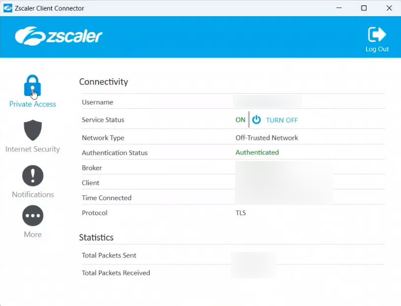
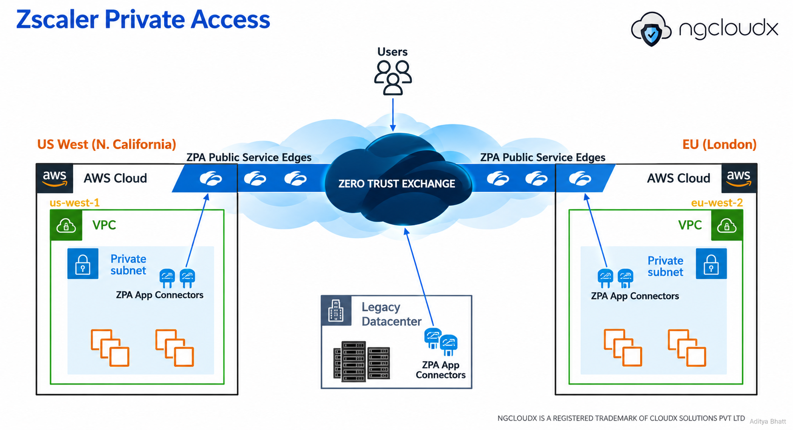

# Zscaler Private Access (ZPA): Architecture, Components & Zero Trust Application Access

**Author:** Aditya Bhatt  
**Domain:** Cloud Security | Zero Trust | Enterprise Network Security

## 1. Introduction

Traditional remote-access architectures often rely on Virtual Private Networks (VPNs) to connect users to corporate networks. Although VPNs provide encrypted connectivity, granting network-level access can expose more resources than a user actually needs.

This is where **Zscaler Private Access (ZPA)** comes into the picture.

ZPA is a Zero Trust Network Access (ZTNA) solution that enables authorized users to connect to specific internal applications without requiring direct access to the underlying corporate network.

Rather than trusting a user simply because they are connected to a VPN, ZPA evaluates access based on identity, application context, configured policies, and other applicable security signals.

The fundamental principle is simple:

> **Connect users to applications, not to the network.**

---

## 2. What Is ZPA?

Zscaler Private Access is part of the Zscaler Zero Trust Exchange platform. It provides secure, policy-driven access to private applications hosted across cloud environments, enterprise data centers, and other supported infrastructure.

These applications may include:

- Internal web applications and APIs
- Private applications hosted in AWS
- Enterprise applications in on-premises data centers
- Applications hosted in distributed or hybrid environments

ZPA is designed to provide application-specific access rather than broad network-level connectivity.

  

*Figure 1: The user end ZPA UI.*

### ZPA vs. Traditional VPN

| Capability | Traditional VPN | ZPA |
|---|---|---|
| Access model | Commonly network-level | Application-specific |
| Trust model | May rely on network membership | Identity- and policy-driven |
| Private application access | Through VPN-connected networks | Through authorized application connectivity |
| Infrastructure exposure | Depends on VPN and network design | Private applications need not be directly exposed to users |
| Segmentation | Often implemented through network controls | Application-level access policies |
| Architecture | VPN gateways and network routing | Zero Trust Exchange and App Connectors |

*Note: Actual capabilities depend on the VPN architecture, ZPA configuration, licensing, and deployed integrations.*

## 3. Understanding ZPA Architecture

A ZPA deployment can support users and applications distributed across multiple locations, including public cloud environments, private data centers, and branch offices.

Its main architectural components are:

### 3.1 Users and Zscaler Client Connector

Users initiate access requests from supported devices. Zscaler Client Connector can establish the client-side connection to ZPA and help identify the user and device context.

Depending on the configuration, authentication and policy evaluation can involve an identity provider, device posture information, and other configured access controls.

**Security objective:** Establish the appropriate user and device context before granting access to a private application.

### 3.2 Zscaler Zero Trust Exchange (ZTX)

The Zero Trust Exchange is the cloud-based security platform underpinning Zscaler services.

Within the ZPA architecture, it facilitates policy-driven access between authorized users and private applications.

Access is not granted merely because a user can reach a particular network. The request must satisfy the applicable access policies.

### 3.3 ZPA Public Service Edge (ZPA PSE)

The ZPA Public Service Edge provides the cloud-side service through which supported user connections reach the ZPA service.

The service edge participates in the secure application-access path and facilitates connectivity between users and authorized private applications.

Multiple service-edge locations can help support geographically distributed users and deployments.

**Key distinction:** A Public Service Edge is part of Zscaler's cloud service, whereas an App Connector is deployed within or near the private application environment.

### 3.4 ZPA App Connectors

App Connectors are deployed within environments that host or provide connectivity to private applications.

They establish outbound connections to the ZPA service and provide the application-side connectivity needed to reach authorized resources.

This design helps avoid requiring unsolicited inbound connections from the internet directly to private applications.

App Connectors may be deployed in environments such as:

- AWS Virtual Private Clouds (VPCs)
- Private cloud environments
- On-premises data centers
- Other supported infrastructure hosting private applications

For availability and resilience, organizations can deploy multiple App Connectors and distribute them across suitable locations and infrastructure.

### 3.5 Application Segments and Access Policies

Application Segments define the private applications or application destinations that ZPA makes available for policy-controlled access.

Access policies determine which users or groups can access those applications under the configured conditions.

For example, an organization might permit members of an engineering group to access an internal development application while restricting access to a production administration interface to an approved administrator group.

This supports least-privilege access and application-level segmentation.

### 3.6 Identity Provider and Device Context

ZPA deployments can integrate with identity providers for authentication and user identity information.

Depending on the deployment, device posture and additional contextual signals may also influence access decisions.

Authentication establishes identity; access policies determine whether the identified user is authorized to access the requested application.

These are related but distinct security functions.

---

## 4. ZPA Architecture: A Multi-Region Deployment

The accompanying architecture diagram illustrates a conceptual deployment spanning multiple environments.

   

*Figure 2: A conceptual representation of ZIA's control plane, distributed service edges, user traffic, and logging infrastructure.*

### US West — Northern California

An AWS environment contains a VPC, private subnet, App Connectors, and internal applications.

The App Connectors maintain outbound connectivity to the ZPA service, enabling authorized users to access supported applications without directly exposing those applications to the public internet.

### EU — London

A second AWS environment illustrates the same pattern in another region.

This represents how organizations can distribute private application infrastructure geographically while maintaining centralized, policy-driven access.

The presence of two regions in the diagram is illustrative; actual high availability and disaster recovery depend on deployment design.

### On-Premises / Legacy Data Center

Not every enterprise workload resides in the public cloud.

App Connectors can also support access to private applications hosted in on-premises data centers, allowing organizations to integrate legacy infrastructure into a Zero Trust access model.

### Branch and Remote Office

Distributed enterprise environments may include additional private application locations and network segments.

The diagram includes a branch or remote-office environment to illustrate that ZPA is not limited to applications hosted in AWS.

The precise connectivity requirements depend on where the applications reside and how the environment is configured.

---

## 5. How Does a ZPA Connection Work?

Consider an employee attempting to access an internal application hosted in a private AWS subnet.

The following sequence provides a simplified view of the access process.

1. **User initiates access:** The employee opens an internal application from their device.
2. **Client-side connectivity:** Zscaler Client Connector provides the configured connection to the ZPA service.
3. **Identity and context evaluation:** The service uses the applicable identity, authentication, and contextual information.
4. **Policy evaluation:** ZPA evaluates whether the user is authorized to access the requested application.
5. **Application-side connectivity:** An appropriate App Connector provides connectivity to the private application through its established connection to the ZPA service.
6. **Secure application session:** If access is permitted and connectivity requirements are satisfied, the user can communicate with the authorized application.
7. **Ongoing security controls:** Applicable policies, monitoring, and session controls operate according to the deployment and service capabilities.

The important architectural detail is that users do not need broad network access simply to reach an individual private application.

*This sequence is a conceptual explanation. Actual connection establishment, service-edge selection, authentication, and session handling depend on the deployed ZPA architecture.*

---

## 6. Why Are App Connectors Important?

App Connectors are a critical part of ZPA because they bridge the ZPA service and the private application environment.

Their placement and connectivity directly affect application reachability.

Consider a scenario in which a user is authorized to access an internal application, but the application is unreachable.

Possible causes include:

- The App Connector is unavailable.
- The connector cannot resolve the application's hostname.
- Network routing or firewall rules block the connection.
- The application is not listening on the expected port.
- The Application Segment is incorrectly configured.
- The access policy does not permit the requested connection.

This highlights an important operational principle:

**Successful authentication does not guarantee successful application connectivity.**

Identity, authorization, connector health, DNS, routing, firewall rules, and application availability must all be considered when investigating access failures.

---

## 7. Security Benefits of ZPA

### Least-Privilege Access

Users receive access to authorized applications rather than automatically gaining access to an entire internal network.

### Reduced Direct Exposure

Private applications do not necessarily need public inbound access for remote users. App Connectors establish outbound connectivity to the ZPA service.

### Application-Level Segmentation

Access policies can help restrict communication to specific applications and authorized user groups.

### Support for Hybrid Environments

ZPA can support private applications across supported cloud and on-premises environments.

### Centralized Policy Management

Organizations can manage application access through centrally defined policies rather than relying exclusively on network-level VPN permissions.

These capabilities help reduce unnecessary exposure, but they do not eliminate the need for secure application configuration, identity security, network controls, monitoring, and incident response.

---

## 8. Practical Troubleshooting: A Security Engineer's Perspective

When troubleshooting a ZPA access issue, it is useful to separate the problem into distinct layers.

| Layer | What to investigate |
|---|---|
| User and identity | Authentication status, identity-provider integration, user/group assignment |
| Client | Client Connector status, device connectivity, relevant client logs |
| Authorization | Application Segment configuration and applicable access policies |
| ZPA service | Relevant service-edge connectivity and service status |
| App Connector | Connector health, availability, and connection status |
| Network | DNS resolution, routes, firewall rules, and required ports |
| Application | Service availability, listener configuration, and application logs |

A practical investigation should establish exactly where the connection fails before changing policies or network rules.

For example, if the user authenticates successfully but the application cannot be reached, immediately broadening access permissions may not solve the problem. The underlying issue could instead be connector health, DNS resolution, routing, or application availability.

### Suggested Investigation Workflow

1. Identify the affected user, application, and time of failure.
2. Confirm authentication and the expected access policy.
3. Verify the Application Segment and destination details.
4. Check App Connector health and relevant connectivity.
5. Validate DNS, routing, firewall rules, and application availability.
6. Review available ZPA logs and timestamps to correlate events.
7. Apply the smallest appropriate corrective change and verify the outcome.

Use authorized administrative access and approved diagnostic procedures. Avoid exposing credentials, sensitive internal hostnames, customer information, or production configuration in public documentation.

---

## 9. ZPA and the Broader Zero Trust Model

ZPA is one part of a broader Zero Trust security strategy.

It focuses on access to private applications. Other controls remain important, including endpoint security, identity governance, data protection, vulnerability management, and security monitoring.

For example, Zscaler Internet Access (ZIA) primarily addresses secure access to internet and SaaS destinations, while ZPA focuses on private application access.

Together, these services can contribute to a broader Zero Trust architecture, depending on an organization's requirements and implementation.

Zero Trust is not achieved simply by deploying a single product. It requires appropriate identity verification, least-privilege authorization, segmentation, visibility, and continuous improvement.

---

## 10. Conclusion

Zscaler Private Access provides a way to modernize private application access without relying solely on traditional network-centric remote-access models.

Its architecture brings together users, identity and access policies, the Zero Trust Exchange, Public Service Edges, and App Connectors to provide authorized access to private applications across supported cloud and enterprise environments.

Understanding how these components interact is useful not only for designing secure architectures, but also for troubleshooting real-world connectivity and access-policy issues.

For security engineers, the most valuable skill is not simply knowing the names of the components. It is understanding how identity, authorization, service connectivity, and application reachability work together.

**Secure access begins with understanding the entire connection path.**

---

### References & Further Reading

- [Zscaler Private Access — Official Product Information](https://www.zscaler.com/products-and-solutions/zscaler-private-access)
- [Zscaler Help Portal](https://help.zscaler.com/)
- [Zscaler Trust Center](https://trust.zscaler.com/)

---

**Article by Aditya Bhatt**  

*Disclaimer: This article is an independent educational overview. Product behavior and terminology should be verified against the applicable Zscaler documentation and deployment version. Zscaler and its product names are trademarks of their respective owner. The architecture illustration is conceptual and is not an official deployment specification.*

---
